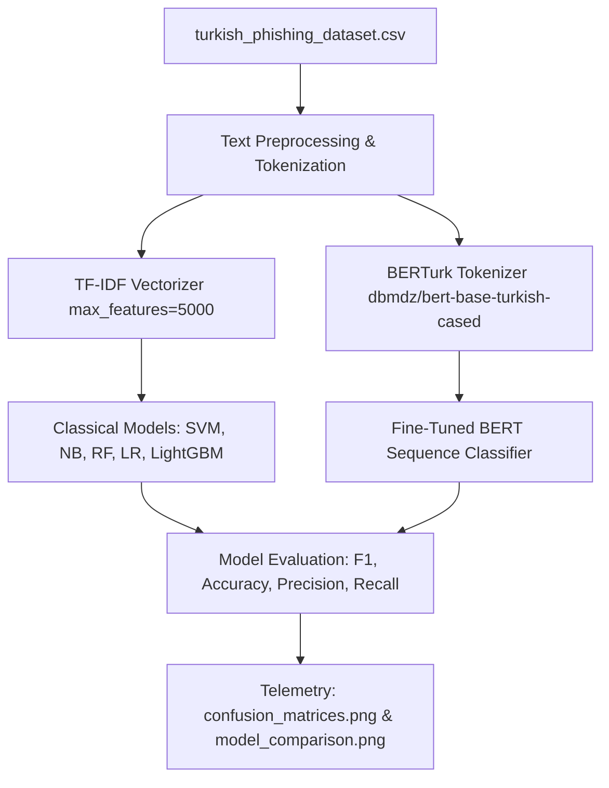

<div align="center">

# Turkish Phishing Email Detection Dataset & Benchmark
### Comparative Evaluation of Fine-Tuned Turkish BERT (`BERTurk`) and Classical Machine Learning Baselines

[](https://www.python.org/)
[](https://pytorch.org/)
[](https://huggingface.co/dbmdz/bert-base-turkish-cased)
[](https://scikit-learn.org/)
[](https://github.com/)
[](LICENSE)

<p align="center">
  <strong>Curated dataset and comparative natural language processing pipeline for classifying legitimate vs. phishing emails in Turkish.</strong>
</p>

---

</div>

## Overview

Phishing attacks remain one of the most critical initial access vectors in cybersecurity. Detecting phishing content in non-English languages presents significant natural language processing challenges due to morphological complexity and limited domain-specific corpora.

This repository provides:
1. **Turkish Phishing Dataset:** A tabular dataset (`turkish_phishing_dataset/turkish_phishing_dataset.csv`) with binary classes (`0: Legitimate`, `1: Phishing`).
2. **Fine-Tuned Transformer Pipeline:** Implementation of `dbmdz/bert-base-turkish-cased` (`BERTurk`) fine-tuned specifically for phishing email classification.
3. **Classical ML Baselines:** Comparative benchmark using TF-IDF feature extraction ($5000$ max features) across Logistic Regression, Naive Bayes, Random Forest, Support Vector Machines (SVM), and LightGBM.
4. **Comprehensive Evaluation Visualizations:** Confusion matrices, F1-score comparisons, and precision-recall trade-offs.

---

## Dataset Source and Limitations

The CSV at `turkish_phishing_dataset/turkish_phishing_dataset.csv` is the same dataset published by Osman Can Çetlenbik as **Turkish Phishing Email Dataset (v1)**. It contains 7,504 records and the columns `ID`, `Konu`, `Gönderen`, `İçerik`, and `Kategori`. The v1 content is synthetic and template-based; it is not a collection of emails from real users.

The dataset is licensed under [CC BY-NC-SA 4.0](https://creativecommons.org/licenses/by-nc-sa/4.0/). This license applies to the dataset only and does not change the licensing of other repository files or code. Kaggle source: Osman Can Çetlenbik, [Turkish Phishing Email Dataset (v1)](https://www.kaggle.com/datasets/osmancancet/turkish-phishing-email-dataset).

A leakage audit result reported for v1 noted that masking reduced the content to seven templates and that the classes could be distinguished using the first three words. This is a reported finding, not an independently verified assessment in this repository.

### Related Work: TurkPhish v2

TurkPhish v2 is a newer, separate dataset and is not the v1 CSV included in this repository:

- Kaggle: [TurkPhish v2: Turkish Phishing E-mail Corpus](https://www.kaggle.com/datasets/osmancancet/turkphish-v2-turkish-phishing-e-mail-corpus)
- Hugging Face: [OsmanCan/turkphish-v2](https://huggingface.co/datasets/OsmanCan/turkphish-v2)
- Çetlenbik, O. C., & Süzen, A. A. (2026). *Applied Sciences, 16*(16), 8274. https://doi.org/10.3390/app16168274

---

## Benchmark Architecture



---

## Repository Structure

```
turkish_phishing_dataset/
├── turkish_phishing_dataset/
│   ├── app.ipynb                   # End-to-end data preparation, training & benchmark notebook
│   ├── turkish_phishing_dataset.csv# Curated Turkish email corpus (labeled)
│   ├── best_bert_model/            # Checkpoint directory for fine-tuned BERTurk
│   ├── model_comparison.png        # Comparative performance metric charts
│   └── confusion_matrices.png      # Multi-model confusion matrix visualizations
└── README.md                       # Research and technical documentation
```

---

## Experimental Workflow

### 1. Environment Setup

```bash
# Clone the repository
git clone https://github.com/SuleymanToklu/turkish_phishing_dataset.git
cd turkish_phishing_dataset

# Install core dependencies
pip install torch transformers scikit-learn pandas numpy matplotlib seaborn
```

### 2. Running Experiments

Open and execute the Jupyter Notebook:

```bash
jupyter notebook turkish_phishing_dataset/app.ipynb
```

The pipeline:
- Loads the dataset and applies stratified $80/20$ train-test splitting.
- Generates sub-word token sequences (max length $128$).
- Trains `BERTurk` with AdamW optimizer and linear learning rate scheduling.
- Computes weighted F1-Scores, Precision, Recall, and Confusion Matrices across all evaluated classifiers.

---

## Licensing

The original code authored for this repository is licensed under the MIT License; see [LICENSE](LICENSE). This license does not apply to the dataset CSV, which is licensed under [CC BY-NC-SA 4.0](https://creativecommons.org/licenses/by-nc-sa/4.0/) as described above, or to third-party materials, which remain under their respective terms.
